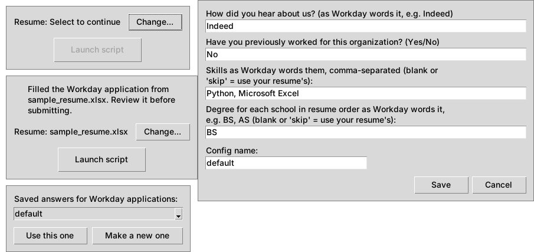

# Job App Script

Fills in the resume part of online job applications from a spreadsheet, in a Chrome window you're already logged into. You pick the file once, and every application after that takes one click. Workday is the first supported portal and `.xlsx` the first file type. New portals and file types are added as single files, with no edits to existing code.



## What it does

1. A small launch window shows which resume it will use. You click **Launch script**.
2. It attaches to your own Chrome (Playwright over the Chrome DevTools Protocol) and finds the tab that's on a supported portal.
3. It asks for that portal's extra answers the first time ("How did you hear about us?", skills in Workday's wording, …) and saves them as a named config for next time.
4. It reads your resume file with the reader for its extension and fills the application with the writer for that portal. On Workday that covers My Information, then *Save and Continue*, then My Experience (jobs, schools, skills, websites, LinkedIn).
5. It stops before anything is submitted and returns to the launch window, so you can review and then start the next application.

Problems such as a missing tab in the sheet, a blank job title, Chrome not reachable, or a page that didn't respond show up as a plain-language popup instead of a traceback.

## How it works

```
main.py (controller) ──► readers/resume_reader.py ── ".xlsx" ──► readers/reader_xlsx.py  read(path)
   │                                                                        │ plain tables
   │                       Resume dataclasses (resume.py)  ◄────────────────┘
   │
   ├──► util/browser.py     attach to Chrome, find a tab (knows nothing about portals)
   ├──► util/gui.py         every tkinter window (knows nothing about readers or writers)
   │
   └──► writers/portal_writer.py ── "workday" in the hostname ──► writers/writer_workday.py  write(page, resume, config)
```

- **Lookup by naming convention.** The extension `xlsx` maps to `readers/reader_xlsx.py`, and a hostname containing `workday` maps to `writers/writer_workday.py`. The plugin files themselves are the list of supported types (`pkgutil.iter_modules`), so there's no registry to keep in sync.
- **Readers only extract.** A reader returns four plain tables (header row first). The shared logic in `resume_reader.py` matches columns by name, converts types, validates required fields, and builds the dataclasses.
- **Errors are translated at each boundary.** openpyxl and Playwright errors become the app's own `AppError` subclasses (`util/errors.py`), and only `main.py` shows them.

## Quick start (Windows)

1. Install [Python 3.10+](https://www.python.org/downloads/) (tick "Add python.exe to PATH") and Google Chrome.
2. Double-click **`run.bat`**.

The first run installs the packages into a private `.venv` folder, which takes about a minute, and after that it only checks for package updates once a week. Each run opens Chrome with remote debugging if it isn't already open that way, and starts the app. That Chrome uses its own profile (`%USERPROFILE%\chrome-profile`), so sign into the job portal there once. Your normal Chrome can stay open.

## Setup (any OS, from a terminal)

Requires Python 3.10+ and Google Chrome.

```bash
pip install -r requirements.txt
```

You don't need to run `playwright install`, because the script uses your installed Chrome instead of downloading a browser.

### Start Chrome with remote debugging

Close every Chrome window, then start Chrome with a debugging port and a separate profile folder. Since Chrome 136 the port only works with a non-default `--user-data-dir`.

```bat
:: Windows
"C:\Program Files\Google\Chrome\Application\chrome.exe" --remote-debugging-port=9222 --user-data-dir="%USERPROFILE%\chrome-profile"
```

```bash
# macOS
"/Applications/Google Chrome.app/Contents/MacOS/Google Chrome" --remote-debugging-port=9222 --user-data-dir="$HOME/chrome-profile"
```

To check it worked, open <http://localhost:9222/json/version>; it should show JSON. Then log into the job portal in that window.

## Usage

```bash
python main.py
```

1. Click **Change...** and pick your resume (try `sample/sample_resume.xlsx` first). It's remembered for later runs.
2. Open a Workday application on the *My Information* step and click **Launch script**.
3. The first time, answer the Workday questions and name the config.
4. Review the filled pages, answer anything company-specific, and submit it yourself.

## Resume spreadsheet format

One tab per section, header row first. Columns can be in any order, and extra columns are ignored. Format phone and zip cells as **Text** so leading zeros survive.

| Tab | Columns | Rows |
|---|---|---|
| Personal | `first`, `last`, `phone`, `email`, `street`, `city`, `state`, `zip_code`, `country`, `linkedin` | one data row |
| General | `skills`, `certifications`, `projects`, `websites`, `clearance` | one item per row, per column |
| Employment | `employer`*, `title`*, `location`*, `start_date`*, `end_date`, `responsibilities`, `supervisor`, `supervisor_contact` | one row per job; blank `end_date` = current job |
| Education | `school`*, `degree`*, `major`*, `start_date`*, `end_date`, `gpa`, `minor` | one row per school |

\* required. Dates can be Excel dates or `YYYY-MM-DD` text. Put each responsibility on its own line in the cell (Alt+Enter).

## Supported types

| File types | Portals |
|---|---|
| `.xlsx` | Workday (`*.myworkdayjobs.com`, `*.myworkdaysite.com`) |

## Adding a file type or portal

**A reader** (e.g. CSV): create `readers/reader_csv.py` with

```python
def read(path: Path) -> Tables:  # (general, personal, employment, education), header row first
    ...
```

**A writer** (e.g. Greenhouse): create `writers/writer_greenhouse.py`, where the name after `writer_` is a word in the portal's hostname:

```python
CONFIG_FIELDS = {"source": "How did you hear about us?"}  # optional: questions not on a resume

def write(page: Page, resume: Resume, config: dict[str, str]) -> None:
    ...  # fill the whole application, including clicking Next
```

Nothing else changes. The file picker, the "supported" messages, and the config dialog all pick up the new file.

## Project structure

```
main.py              controller: launch window → one application → back
run.bat              Windows launcher: setup, Chrome, run
resume.py            Resume dataclasses
readers/             resume_reader.py (dispatch + shared logic), reader_xlsx.py
writers/             portal_writer.py (dispatch + configs), writer_workday.py
util/                browser.py, gui.py, errors.py, settings.py
tests/               pytest suite (no browser needed)
sample/              sample_resume.xlsx (fake data)
```

## Development

```bash
pip install -r requirements-dev.txt
pytest            # tests: reader logic, dispatch, configs, option matching
ruff check .      # lint
ruff format .     # format
mypy .            # type check
```

## Building an executable

```bash
pyinstaller --onefile --name JobAppScript --collect-submodules readers --collect-submodules writers main.py
```

`--collect-submodules` is required because readers and writers are imported by name at runtime (`importlib.import_module("readers.reader_" + ext)`), which PyInstaller can't see by scanning imports. Saved configs and the remembered resume go in a `configs/` folder next to the executable. The build keeps a console window open, which shows the per-field messages (e.g. a skill Workday didn't recognize).

## Known limitations

- Only major portal providers are in scope. A company careers site on its own domain that embeds Workday won't be detected.
- Workday only accepts values from each company's own lists (degrees, skills, "How did you hear about us?"). Values without a clear match are skipped with a console message, and Field of Study uses Workday's closest result.
- If your Workday profile already has jobs or schools on *My Experience*, the resume's entries are added after them, so you may need to delete duplicates.
- Selectors come from Workday's markup as of October 2026 and may need updating if Workday changes it.

## Responsible use

This is a personal tool. It fills forms in a browser session you start and log into yourself, it never submits an application, and you review every page before submitting. It doesn't bypass logins, CAPTCHAs, or any portal protections. Don't commit real resume data, the Chrome profile folder, or `configs/`; `.gitignore` already excludes them.
